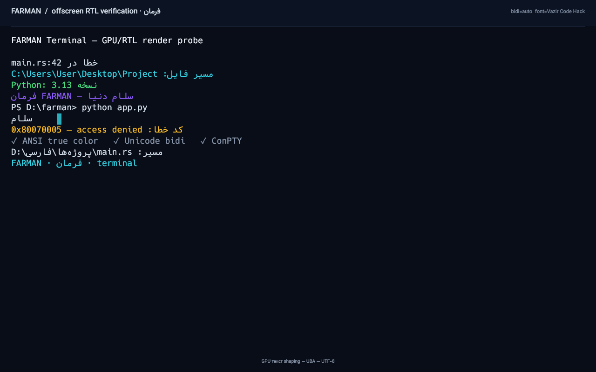

# FARMAN Terminal · فرمان

FARMAN is a native Windows terminal written in Rust, built around real
ConPTY shell sessions and a GPU-rendered terminal grid. Its differentiator is
first-class Persian/Arabic shaping and Unicode bidirectional layout without
rewriting shell input or corrupting the logical terminal buffer.


Offscreen GPU render probe (real wgpu readback, mixed RTL):



A live glass session with Persian output:
[persian-session.png](docs/images/persian-session.png). The settings sheet:
[settings.png](docs/images/settings.png) and the profile menu:
[profile-menu.png](docs/images/profile-menu.png).

## What works

- **Real shells over ConPTY** — Windows PowerShell, PowerShell 7, Command
  Prompt, WSL when installed, and user-defined profiles. Input/output are
  transported through pseudo-console pipes; no command output is simulated.
- **Proven VT engine** — [`alacritty_terminal`](https://crates.io/crates/alacritty_terminal)
  handles ANSI/VT parsing, 16/256/true color, scrolling, wrapping, alternate
  screen, resize and terminal modes.
- **GPU terminal** — [`winit`](https://crates.io/crates/winit) + [`wgpu`](https://crates.io/crates/wgpu)
  + [`glyphon`](https://crates.io/crates/glyphon) + [`cosmic-text`](https://crates.io/crates/cosmic-text)
  render cell backgrounds, shaped text and the UI on the GPU.
- **Glassmorphism, kept minimal** — floating translucent header/status cards,
  a large rounded terminal pane, soft radial light fields, one-pixel glass
  rims, very soft shadows, and a subtle frosted grain. The terminal remains the
  dominant, high-contrast focus.
- **Custom frameless chrome** — borderless window with DWM dark mode and
  rounded corners, an in-app title bar, tabs, profile chip and window controls,
  plus edge drag-resize.
- **Persian shaping** — bundled OFL **Vazir Code Hack** monospaced font with
  HarfRust Arabic contextual shaping (`init`/`medi`/`fina`), combining marks,
  RTL runs, and mixed Persian/English/number/punctuation lines.
- **Logical/visual separation** — the terminal grid stays in logical order.
  Unicode bidi visual ordering is computed per row and mapped back to cell
  coordinates for painting, hit-testing, selection and the cursor.
- **Windows paths stay intact** — path/URL tokens are wrapped in visual-only
  LTR isolates, so `D:\پروژه‌ها\فارسی\main.rs` keeps its component order while
  the shell still receives exactly the original text.
- **Tabs, profiles and settings** — compact tab bar, shell profile menu,
  settings panel with font size, three themes, default shell, bidi toggle,
  config path and reload. The UI is English-first with Pinar typography.
- **Clipboard** — logical-order selection/copy, bracketed paste, OSC 52 copy
  support, configurable shortcuts that work with a Persian keyboard layout.
- **Safety** — built-in PowerShell profiles use `-NoProfile`; CMD uses `/D`
  (no AutoRun); no telemetry, no network access, and no shell content in logs.
- **Clean shutdown** — closing FARMAN terminates the ConPTY child process,
  conhost helpers, reader/writer threads and native handles.

## Build and run

Requirements: Windows 10 1809+ (2022-era ConPTY API), Rust stable MSVC, Visual
Studio Build Tools, Windows SDK. This checkout was built with Rust 1.93.1 and
the Windows 10.0.26100 SDK.

```powershell
# In this environment the stable toolchain exists but is not on PATH:
$env:Path = "$env:USERPROFILE\.rustup\toolchains\stable-x86_64-pc-windows-msvc\bin;$env:Path"

# Development build and launch
cargo run

# Tests (includes Windows-only ConPTY integration tests)
cargo test

# Release build
cargo build --release
# executable: target\release\farman.exe

# Per-user Windows installer (requires Inno Setup 6)
powershell -ExecutionPolicy Bypass -File scripts\build-installer.ps1
# installer: dist\FARMAN-Terminal-<version>-win64-setup.exe
```

The release executable embeds the terminal/UI fonts and the application icon;
it is a single-file portable application.

### Diagnostics

```powershell
# Print HarfRust/cosmic-text shaping positions for Persian and mixed samples
cargo run -- --text-probe

# Render a mixed Persian/English scene offscreen through wgpu and save a PNG
cargo run -- --render-test target\rtl-render.png
```

The offscreen probe is a real GPU render through the same glyph atlas and text
pipeline as the window; it reports non-background pixel counts and fails if the
scene is blank.

## Keyboard shortcuts

Shortcuts use physical keys as a fallback, so they work while a Persian
keyboard layout is active. Text input always uses the logical key produced by
the OS layout/IME.

| Action | Default |
| --- | --- |
| New tab | `Ctrl+Shift+T` |
| Close tab | `Ctrl+Shift+W` |
| Copy selection | `Ctrl+Shift+C` / `Ctrl+Insert` |
| Paste | `Ctrl+Shift+V` / `Shift+Insert` |
| Settings | `Ctrl+,` |
| Increase/decrease font | `Ctrl+=` / `Ctrl+-` |
| Reset font size | `Ctrl+0` |
| Next/previous tab | `Ctrl+Tab` / `Ctrl+Shift+Tab` |
| Select tab | `Ctrl+1` … `Ctrl+9` |
| Scrollback | `Shift+PageUp` / `Shift+PageDown`, wheel |
| Fullscreen | `F11` |
| Close overlays | `Escape` |

Shortcuts are configurable in `config.toml`.

## Configuration

Configuration is versioned TOML and lives at:

```
%APPDATA%\FARMAN\config.toml
```

Logs are written to `%LOCALAPPDATA%\FARMAN\logs\farman.log.<date>` and contain
only diagnostics/errors, never shell input or output.

A commented example is in [config.example.toml](config.example.toml). Invalid
configuration is never silently overwritten: FARMAN backs up the invalid file
and starts with validated defaults.

Custom shell profiles are explicit and execute only the configured program:

```toml
[profiles.my-shell]
name = "My PowerShell"
program = "C:\\Program Files\\PowerShell\\7\\pwsh.exe"
args = ["-NoLogo"]
cwd = "D:\\work"
```

## Documentation

- [Architecture and dependency decisions](docs/ARCHITECTURE.md)
- [Known limitations and unsupported cases](docs/LIMITATIONS.md)
- [Testing and verification record](docs/TESTING.md)
- [Packaging and installation](docs/PACKAGING.md)

## Fonts and licenses

Application code is MIT licensed (see [LICENSE](LICENSE)).

- **Vazir Code Hack** — OFL, by Saber Rastikerdar / Vazir Code project. See
  `assets/fonts/OFL-Vazir-Code.txt`.
- **Vazirmatn** — OFL, by Saber Rastikerdar. Used as a UI symbol fallback. See
  `assets/fonts/OFL-Vazirmatn.txt`.
- **Pinar** — UI typeface, © 2020 fontamin.com, all rights reserved; the Latin
  section is based on Commissioner (OFL 1.1). See `assets/fonts/NOTICE-Pinar.txt`.

The fonts are embedded in the executable (`include_bytes!`) so a portable copy
renders Persian correctly without system font installation.

## Status

This is a Phase 1/2 milestone, not a claim of universal terminal or RTL
compatibility. See [docs/LIMITATIONS.md](docs/LIMITATIONS.md) before relying on
it for interactive full-screen RTL content.

The glass treatment is an in-app GPU glassmorphism layer. The DX12 wgpu surface
on the tested system exposes only the `Opaque` composite alpha mode, so the
window does not blur the desktop behind it. The borderless window still uses
DWM dark mode and rounded corners. This is a visual limitation, not a
terminal-function limitation.
