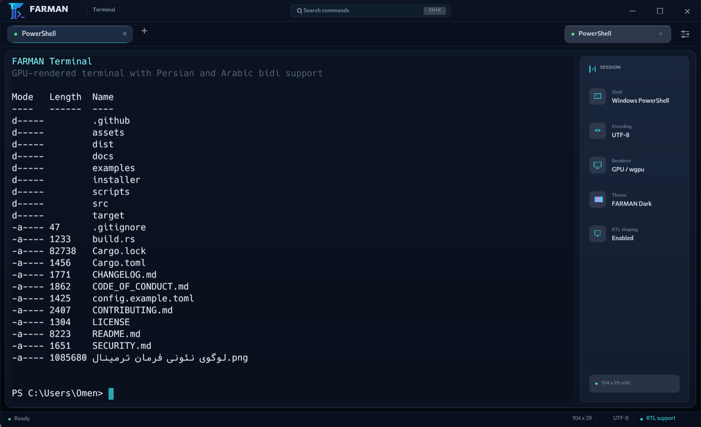
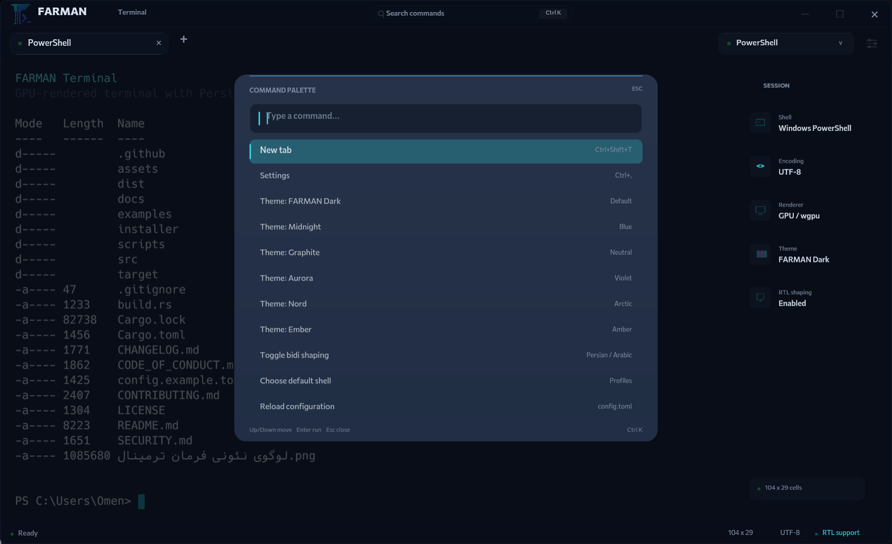

# FARMAN Terminal · فرمان

**A native Windows terminal with first-class Persian and Arabic text.**
**ترمینالی مدرن برای ویندوز با پشتیبانی کامل از فارسی و عربی.**

[](https://github.com/ShahBazTeam/farman/releases)
[](LICENSE)
[](#requirements)
[](https://www.rust-lang.org/)



FARMAN is a GPU-rendered Windows terminal built on real ConPTY sessions. It
keeps the terminal buffer in logical order while shaping and reordering
Persian/Arabic runs per row, so shell input, copy/paste, paths and cursor
positions remain correct.

## Highlights

- **Persian and Arabic, done properly** - embedded Vazir Code Hack plus
  HarfRust contextual shaping, combining marks, bidi runs, and visual-only LTR
  isolation for paths and URLs.
- **Command palette** - press `Ctrl+K` or click the title-bar search field to
  switch themes, open settings, reload config, toggle bidi shaping or choose a
  shell without leaving the keyboard.
- **Trilingual installer** - the Windows setup wizard is available in
  **English**, **فارسی**, and **العربية**, including RTL layout.
- **Real shells, not a mock** - FARMAN is the terminal emulator; Windows
  PowerShell, PowerShell 7, Command Prompt, WSL when installed, and custom
  profiles run as shells behind ConPTY. Profiles are discovered locally and can
  be replaced in `config.toml`.
- **GPU terminal** - `winit` + `wgpu` + `glyphon` + `cosmic-text`, with ANSI/VT
  parsing from `alacritty_terminal`.
- **Focused glass UI** - frameless custom chrome, translucent cards, soft
  shadows, accent gradients, a live session inspector, tabs, profile menu and
  a settings sheet. The terminal stays the dominant, high-contrast surface.
- **Six built-in themes** - FARMAN Dark, Midnight Blue, Graphite, Aurora, Nord
  and Ember, with a visual theme gallery in Settings and instant switching from
  the command palette.
- **Native details** - DWM dark mode and rounded corners, per-monitor DPI,
  edge drag-resize, Windows clipboard, OSC 52 copy, bracketed paste.
- **Private by default** - no telemetry, no network access, and no shell
  content in logs.

## Command palette



`Ctrl+K` opens a keyboard-first palette with fuzzy multi-term filtering,
`Up`/`Down` navigation, and `Enter` to run. It includes every built-in theme
and the bidi toggle, so the most useful settings are one keystroke away.

## Themes

Open **Settings** (`Ctrl+,`) to see the theme gallery. Each card previews the
background, accent colors and ANSI palette, and applies the theme instantly.
The choice is saved to `config.toml`.

| Theme | Mood |
| --- | --- |
| FARMAN Dark | Cyan on deep ink |
| Midnight Blue | Cool blue hour |
| Graphite | Restrained neutral |
| Aurora | Violet and magenta |
| Nord | Arctic blue |
| Ember | Warm amber |

## Install

Download the latest build from the
[releases page](https://github.com/ShahBazTeam/farman/releases/latest).

| Package | Best for |
| --- | --- |
| `FARMAN-Terminal-<version>-win64-setup.exe` | Per-user install, Start Menu shortcut, uninstaller |
| `FARMAN-Terminal-<version>-win64.zip` | Portable use, no installation |

The installer asks for English, Persian or Arabic and requires no elevation. It
installs to `%LOCALAPPDATA%\Programs\FARMAN Terminal` and leaves configuration
and logs in place when uninstalled.

### Requirements

- Windows 10 1809 or newer, or Windows 11, x64.
- For building: Rust stable MSVC, Visual Studio Build Tools, Windows SDK.

## Build from source

```powershell
# If Rust is installed but not on PATH:
$env:Path = "$env:USERPROFILE\.rustup\toolchains\stable-x86_64-pc-windows-msvc\bin;$env:Path"

cargo test
cargo run

# Release executable
cargo build --release
# target\release\farman.exe

# Portable ZIP
powershell -ExecutionPolicy Bypass -File scripts\package.ps1

# Windows installer (requires Inno Setup 6)
powershell -ExecutionPolicy Bypass -File scripts\build-installer.ps1
# dist\FARMAN-Terminal-<version>-win64-setup.exe
```

The release executable embeds the terminal/UI fonts and application icon, so the
portable build is a single file. Configuration is created at
`%APPDATA%\FARMAN\config.toml`; logs go to
`%LOCALAPPDATA%\FARMAN\logs\farman.log.<date>`.

### Diagnostics

```powershell
# Print HarfRust/cosmic-text shaping positions for Persian and mixed samples
cargo run -- --text-probe

# Render a mixed Persian/English scene offscreen through wgpu and save a PNG
cargo run -- --render-test target\rtl-render.png
```

The offscreen probe uses the same glyph atlas and text pipeline as the window,
and fails if the scene is blank.

## Keyboard shortcuts

Shortcuts use physical keys as a fallback, so they keep working with a Persian
keyboard layout. Text input always follows the logical key from the OS layout or
IME.

| Action | Default |
| --- | --- |
| Command palette | `Ctrl+K` |
| New tab | `Ctrl+Shift+T` |
| Close tab | `Ctrl+Shift+W` |
| Copy selection | `Ctrl+Shift+C` / `Ctrl+Insert` |
| Paste | `Ctrl+Shift+V` / `Shift+Insert` |
| Settings | `Ctrl+,` |
| Increase/decrease font | `Ctrl+=` / `Ctrl+-` |
| Reset font size | `Ctrl+0` |
| Next/previous tab | `Ctrl+Tab` / `Ctrl+Shift+Tab` |
| Select tab | `Ctrl+1` ... `Ctrl+9` |
| Scrollback | `Shift+PageUp` / `Shift+PageDown`, wheel |
| Fullscreen | `F11` |
| Close overlays | `Escape` |

Shortcuts other than the palette are configurable in `config.toml`.

## Configuration

```toml
[font]
family = "Vazir Code Hack"
size = 15.0
line_height = 1.35

[window]
width = 1180
height = 760

[bidi]
enabled = true
```

A commented example is in [config.example.toml](config.example.toml). Invalid
configuration is never silently overwritten: FARMAN backs up the invalid file
and starts with validated defaults.

Custom shell profiles are explicit and execute only the configured program:

```toml
[profiles.my-shell]
name = "My PowerShell"
program = "C:\\Program Files\\PowerShell\\7\\pwsh.exe"
args = ["-NoLogo"]
cwd = "D:\\work"
```

## Documentation

- [Architecture and dependency decisions](docs/ARCHITECTURE.md)
- [Known limitations](docs/LIMITATIONS.md)
- [Testing and verification record](docs/TESTING.md)
- [Packaging and installation](docs/PACKAGING.md)
- [Contributing](CONTRIBUTING.md)
- [Security policy](SECURITY.md)

## Project layout

```
src/            terminal, renderer, UI, config, profiles, ConPTY session
assets/         icons, embedded fonts, font licenses
installer/      Inno Setup script and translations
scripts/        build, package and per-user install helpers
docs/           architecture, limitations, testing, packaging, screenshots
examples/       small sample sessions
```

## Fonts and licenses

Application code is MIT licensed. See [LICENSE](LICENSE).

- **Vazir Code Hack** - OFL, by Saber Rastikerdar / Vazir Code project.
- **Vazirmatn** - OFL, by Saber Rastikerdar. UI symbol fallback.
- **Pinar** - UI typeface, c 2020 fontamin.com, all rights reserved; the Latin
  section is based on Commissioner (OFL 1.1). The font is redistributed with
  this project with the bundled notice; verify that this use fits your own
  distribution before shipping a fork.

The fonts are embedded in the executable with `include_bytes!`, so a portable
copy renders Persian correctly without installing system fonts.

## Status

This is an early public milestone, not a claim of universal terminal or RTL
compatibility. See [docs/LIMITATIONS.md](docs/LIMITATIONS.md) before relying on
it for interactive full-screen RTL content.

The glass treatment is an in-app GPU layer. The DX12 wgpu surface on the tested
system exposes only the `Opaque` composite alpha mode, so the window does not
blur the desktop behind it. The borderless window still uses DWM dark mode and
rounded corners.
